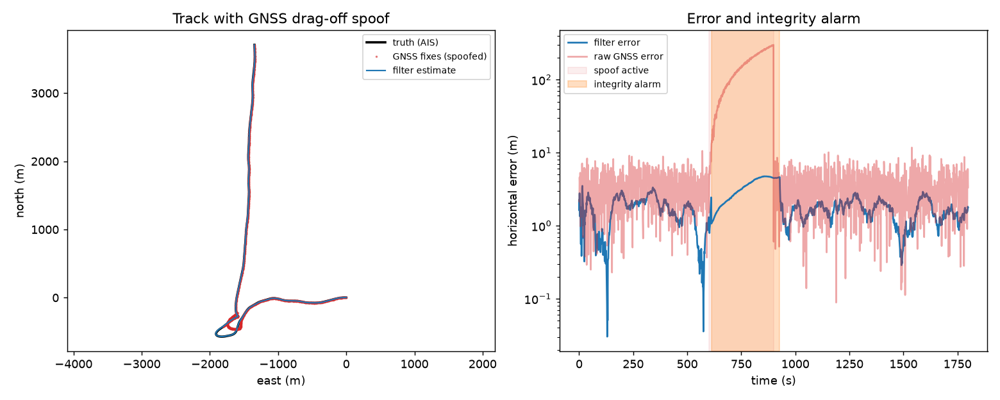

# Maritime PNT Integrity Monitor & Verification Toolkit

A navigation filter that keeps a ship's position trustworthy when GNSS is lost, jammed or spoofed, and a
systems-engineering toolkit that verifies it against written requirements, producing a requirements
verification matrix from Monte Carlo runs over real vessel tracks off San Diego.



*A drag-off spoof pulls the GNSS position more than 300 m off track (red). The integrity monitor raises an alarm
within seconds, rolls the filter back to before the attack, and holds position on dead reckoning (blue) until
GNSS is consistent again.*

## Overview

- **Truth:** 20 real vessel tracks from one day of U.S. Coast Guard AIS data (June 15, 2023) in the San Diego
  approaches, interpolated to 1 Hz.
- **Sensors (simulated on those tracks):** GNSS at 1 Hz with white noise and slowly varying bias; speed log and
  gyrocompass at 10 Hz with scale-factor and bias errors; an unknown water current per run.
- **Threats:** a 300 s GNSS outage, jamming (25 m noise, reported by the receiver), and a drag-off spoof at
  0.5, 1 or 2 m/s in a random direction (not reported by the receiver).
- **Filter:** extended Kalman filter fusing GNSS with dead reckoning and estimating the current.
- **Integrity monitor:** per-fix and sliding-window chi-square tests on the innovations, with rollback and replay
  on alarm.
- **Verification:** `requirements.yaml` holds 8 numbered requirements with thresholds and verification methods;
  `pntv verify` runs the Monte Carlo and writes `results/verification_matrix.md`.

## Results

From `results/verification_matrix.md` and `results/metrics.json`: 480 runs (20 tracks × 6 seeds × 4 scenarios),
60 hours of nominal operation, 120 spoofing attacks. **All 8 requirements pass.**

| ID | Requirement | Required | Measured |
|---|---|---|---|
| PNT-001 | Nominal accuracy, 95th percentile | ≤ 5 m | 3.02 m |
| PNT-002 | 300 s GNSS outage, 95th percentile | ≤ 50 m | 10.97 m |
| PNT-003 | Jamming, 95th percentile | ≤ 20 m | 6.87 m |
| PNT-004 | Spoofs detected | ≥ 95% | 98.3% (118 of 120) |
| PNT-005 | Time to alert, 95th percentile | ≤ 60 s | 23 s |
| PNT-006 | Error during spoofing, 95th percentile | ≤ 50 m | 11.44 m |
| PNT-007 | False alarms | ≤ 1 per 10 h | 0.33 per 10 h (2 in 60 h) |
| PNT-008 | Filter step time, 99th percentile | ≤ 1 ms | 0.086 ms |

## Architecture

```
NOAA AIS daily file ──▶ ais.py: vessel segments ──▶ 1 Hz truth (Hermite, uses reported speed/course)
                                                        │
                       sensors.py: GNSS, speed log, gyrocompass + outage / jamming / spoofing
                                                        │
                       ekf.py: EKF [east, north, current] + integrity monitor (NIS tests, rollback)
                                                        │
requirements.yaml ──▶  verify.py: Monte Carlo ─▶ metrics ─▶ verification matrix (md / csv / json) + plot
```

## Setup

```bash
uv venv && uv pip install -e ".[dev]"      # or: python -m venv .venv && pip install -e ".[dev]"
```

The extracted tracks are committed (`data/tracks/`). To rebuild them from the raw AIS file (319 MB):

```bash
curl -L -o data/raw/AIS_2023_06_15.zip https://coast.noaa.gov/htdata/CMSP/AISDataHandler/2023/AIS_2023_06_15.zip
pntv extract data/raw/AIS_2023_06_15.zip
```

## Usage

```bash
pntv verify                      # ~70 s: Monte Carlo, verification matrix, example plot in results/
pntv verify --seeds 2            # quicker run
```

Change a threshold in `requirements.yaml` or a sensor parameter in `sensors.py` and re-run to see which
requirements still pass.

## Design decisions

- **Dead reckoning a ship actually has.** The speed log and gyrocompass measure motion through the water, so
  an unknown current makes pure dead reckoning drift. The filter estimates the current from GNSS, which is what
  keeps the 300 s outage error near 11 m.
- **Two integrity tests.** Normalized innovation squared (NIS) is chi-square with 2 degrees of freedom when GNSS is
  healthy. A single fix above the 99.9% bound is rejected. A slow drag-off passes single-fix tests, so the sum of NIS
  over a 30 s window is tested against a 99.999% bound; when it fails, GNSS is declared untrusted.
- **Rollback and replay.** Before the alarm, the filter has already absorbed part of the spoof into its current
  estimate, and coasting on that estimate drifted to 40 m in early testing. On alarm, the filter restores its state
  from the start of the window and replays dead reckoning without those fixes. That keeps error during spoofing
  to about 11 m (95th percentile) instead of tens of metres.
- **Recovery.** GNSS is trusted again after a full window of fixes passes the single-fix test against the coasted
  estimate.
- **Requirements first.** Thresholds were written before the first verification run. The matrix reports FAIL
  honestly; the test suite checks that a failing metric produces a FAIL row.

## Limitations

- AIS in this dataset is sampled about once a minute, so the 1 Hz truth is interpolated; manoeuvres shorter than
  a minute are smoothed.
- Sensors are simulated; no real GNSS or inertial data. No leeway, wave motion or heading-dependent speed error.
- The spoofer is a simple constant-rate drag-off; an adversary that matches the dead-reckoning drift would be harder
  to detect.
- Time-to-alert is measured only for detected spoofs; the 2 undetected runs count against PNT-004.

## Testing

```bash
pytest           # 9 tests, offline, < 1 s, on a synthetic straight-line track
ruff check .
```

Covers coordinate conventions, truth interpolation, chi-square bounds, nominal accuracy, outage holdover, spoof
detection and containment at two drag rates, recovery after the spoof, and requirement evaluation including FAIL
rows. GitHub Actions runs lint and tests on every push.

## Data & licensing

AIS data: Bureau of Ocean Energy Management and NOAA, [MarineCadastre.gov](https://marinecadastre.gov/ais/),
U.S. Government data. Only the extracted San Diego segments (460 KB) are committed. Code: MIT (see `LICENSE`).

## AI assistance disclosure

Built with help from Claude (Anthropic) via Claude Code; I reviewed, tested and verified the code and results.
